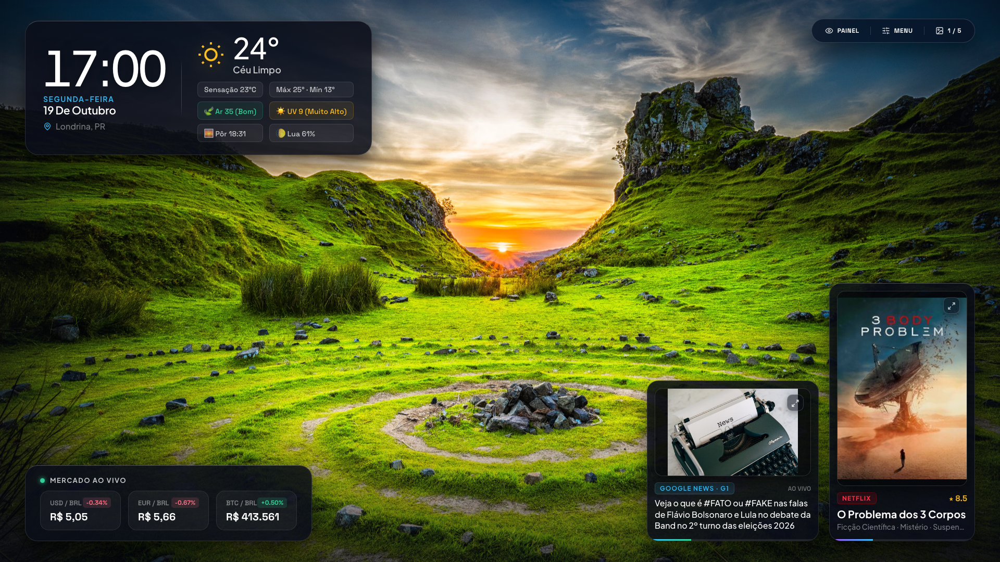
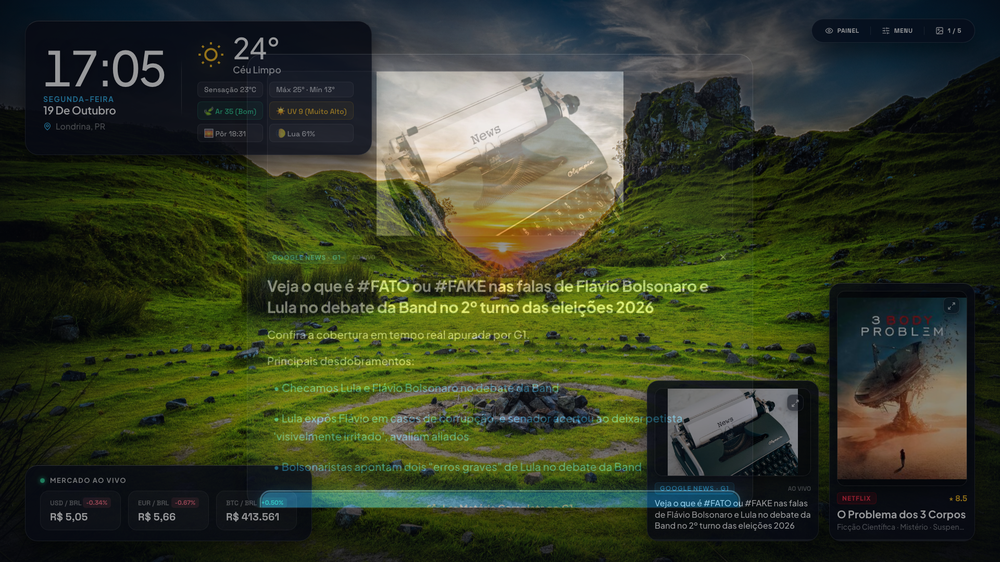
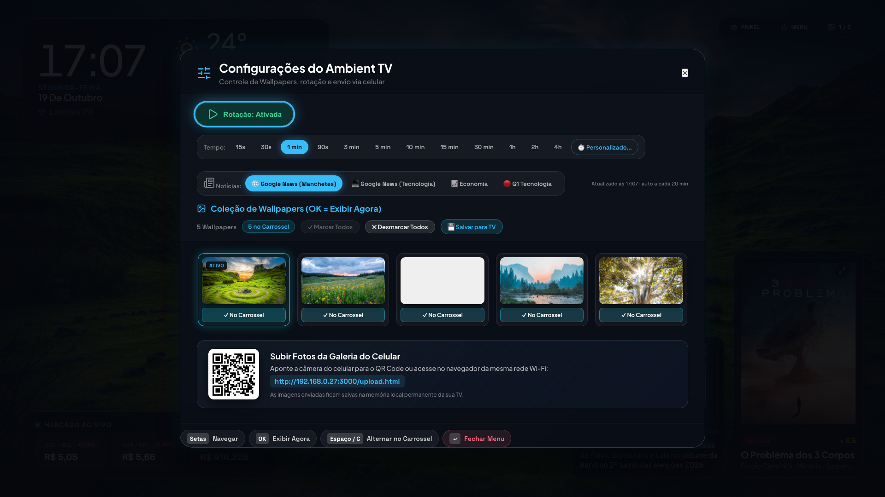

<div align="center">

  

  # AmbiFrame

  ### Transform any Samsung Smart TV into a gallery-grade ambient art piece.

  <p align="center">
    <strong>Daily 4K Unsplash Photography • Real-Time Weather & Air Quality • Regional News • Trending Streaming • Financial Ticker</strong>
  </p>

  <p align="center">
    <a href="#-quick-start"><strong>Quick Start »</strong></a> •
    <a href="#-screenshots">View Screenshots</a> •
    <a href="#-features">Features</a> •
    <a href="#-tv-remote-controls">Remote Controls</a> •
    <a href="#-installation-methods">Installation</a> •
    <a href="#-personal-readme-badge">Profile Badge</a>
  </p>

  <p align="center">
    <a href="https://github.com/guconstantino/ambiframe/releases"></a>
    <a href="LICENSE"></a>
    <a href="https://developer.samsung.com/smarttv"></a>
    
    
  </p>

</div>

---

<div align="center">
  
  <p><em>AmbiFrame running live on a Samsung 50" 4K QLED TV — Master Clock, Weather, Market Ticker, News & Streaming Radar.</em></p>
</div>

---

## 💡 Why AmbiFrame?

Samsung's official **The Frame** TVs sell for over \$1,500, and stock "Ambient Mode" on standard Crystal/QLED TVs is often ad-heavy, restricted to proprietary subscriptions, or drains resources with bloated code.

**AmbiFrame is the open-source answer.**

Built from scratch with zero framework bloat, AmbiFrame turns **any Samsung Smart TV (Tizen 3.0+)** or web-connected screen into a high-end, responsive, and completely ad-free living dashboard:
- 🖼️ **5 Fresh 4K Wallpapers Every Day** via Unsplash (deterministic date-seeded rotation).
- ⛅ **Hyper-Local Climate Station** via Open-Meteo (real-time temp, rain probability, AQI, UV, sun & moon phases).
- 📰 **Interactive News Headlines** via Google News & G1 with full-screen reading modal & mobile QR transfer.
- 🎬 **Trending Streaming Radar** powered by TMDB with posters, ratings, and synopsis.
- 📈 **Financial Ticker** with live USD, EUR, and Bitcoin exchange rates.
- 🛡️ **OLED/QLED Anti-Burn-In Engine** with smooth sub-pixel shifting.
- ⚡ **Ultra-Lightweight** — The entire `.wgt` install package is **under 2 MB**.

---

## 📸 Screenshots

<div align="center">
  <table>
    <tr>
      <td width="50%">
        
        <p align="center"><strong>Interactive News Reading Modal</strong><br/><em>Full-screen reading view, editorial summaries, related headlines & QR code for mobile.</em></p>
      </td>
      <td width="50%">
        
        <p align="center"><strong>Wallpaper & Preferences Menu</strong><br/><em>Live thumbnails, rotation intervals, news feed selector, and mobile photo uploader.</em></p>
      </td>
    </tr>
  </table>
</div>

---

## ✨ Features

### 🎨 1. Daily 4K Wallpaper Engine (Unsplash)
* **Date-Seeded Algorithm (`YYYY-MM-DD`):** Every calendar day, AmbiFrame algorithmically picks 5 fresh 4K landscape masterpieces from Unsplash. All devices worldwide receive a unified daily exhibition.
* **Offline Guarantee:** 5 high-res royalty-free landscape photographs are permanently bundled in the app. If your TV turns on without internet, it never stays black.
* **Auto-Adaptive Typography:** Automatically measures wallpaper luminance and adjusts clock contrast, shadows, and positioning according to Gestalt principles.

### ⛅ 2. Real-Time Atmospheric Station (Open-Meteo)
* **Zero API Key Required:** Connects directly to Open-Meteo's open APIs.
* **Detailed Metrics:** Temperature, feels-like temperature, hourly rain probability, daily min/max, UV index, sunrise & sunset times, and astronomical moon phase calculation.
* **European Air Quality Index (AQI):** Displays real-time air quality score and classification (Good, Moderate, Unhealthy).

### 📰 3. Multi-Region News Radar & Reader
* **Live Feeds:** Real-time headlines from Google News (Top Stories, Technology, Business) and G1.
* **Clean Reading Experience:** Eliminates messy RSS description tags. Displays clean 16:9 thumbnails, headline badges, and formatted paragraphs.
* **Seamless Mobile Transfer:** Generates a dynamic QR code on screen so you can send the full article to your phone in one scan.
* **D-Pad Navigation:** Browse forward and backward through articles directly from your remote control.

### 🎬 4. Trending Streaming Radar (TMDB)
* Curates trending movies and series across Netflix, Prime Video, Apple TV+, and HBO Max.
* Displays high-res vertical posters, community ratings, synopsis, and release years.

### 🛡️ 5. OLED & QLED Anti-Burn-In Protection
* Integrated **Pixel Shift Engine** subtly moves UI containers by $\pm 10\text{px}$ every 5 minutes.
* Fully invisible to the naked eye, but prevents persistent image burn-in during long hours of operation.

---

## 🎮 TV Remote & Keyboard Controls

AmbiFrame is designed for **first-class spatial D-Pad navigation**. It works out of the box with standard Samsung Smart Remotes, Solar Cell Remotes, and keyboard shortcuts:

| Key | TV Remote Button | Action |
|---|---|---|
| **Arrow Right (►)** | D-Pad Right | Focus Streaming Card / Next Wallpaper |
| **Arrow Left (◄)** | D-Pad Left | Focus News Card / Previous Wallpaper |
| **Arrow Up / Down (▲/▼)** | D-Pad Up / Down | Navigate between widgets and upper HUD |
| **Enter / Space** | Center / Select | Open Reading View, Movie Details, or activate Wallpaper |
| **Arrow Left / Right (◄/►)** | Inside Modal | Browse between 10 News stories or Trending movies |
| **Menu / Tools (M / S)** | Menu / Tools (`10133`) | Open / Close Settings Menu |
| **Return / Esc** | Return (`10009`) | Close active modal / Exit |

---

## 🚀 Quick Start

### Option A: Run in Web Browser (Instant Test)

No dependencies or build steps required. AmbiFrame runs on any modern browser:

```bash
# 1. Clone the repository
git clone https://github.com/guconstantino/ambiframe.git
cd ambiframe

# 2. Start a local server (using npx or python)
npx serve -l 3000 .
# or
python3 -m http.server 3000
```

Open `http://localhost:3000/` in your browser.

---

### Option B: 1-Click Install on Samsung Smart TV (Tizen Homebrew)

If your Samsung TV is in Developer Mode with the [Tizen Homebrew Channel](https://github.com/reisxd/TizenBrew) service active on port 8091:

```bash
# From inside the ambiframe directory:
curl -v \
  -H "Content-Type: application/octet-stream" \
  -H "x-homebrew-pin: YOUR_TV_PIN" \
  -H "x-homebrew-name: ambiframe-v1.0.0.wgt" \
  -H "Expect:" \
  --data-binary "@dist/ambiframe-v1.0.0.wgt" \
  http://<TV_IP_ADDRESS>:8091/install
```

---

### Option C: Official Tizen CLI / Tizen Studio

```bash
# 1. Build the .wgt package
chmod +x build_wgt.sh
./build_wgt.sh

# 2. Connect to your Samsung TV
sdb connect <TV_IP_ADDRESS>:26101

# 3. Install the package
tizen install -s <TV_IP_ADDRESS>:26101 -n ambiframe-v1.0.0.wgt
```

---

## 📁 Repository Structure

```
ambiframe/
├── assets/
│   ├── icon.png                 # 512x512 app icon
│   ├── qr_upload.png            # QR Code asset for local photo upload
│   ├── screenshots/             # High-res README screenshots
│   ├── thumbnails/              # Local optimized offline thumbnails
│   └── wallpapers/              # 5 bundled royalty-free 4K offline wallpapers
├── css/
│   └── style.css                # Gestalt design system, glassmorphism & typography
├── js/
│   ├── anime.min.js             # Micro-interactions and UI transitions
│   ├── lucide.min.js            # SVG icons
│   ├── wallpapers.js            # Daily Unsplash 4K rotation engine
│   ├── default_config.js        # Default config & initial states
│   └── app.js                   # Master orchestrator & TV D-Pad controller
├── config.xml                   # Samsung Tizen manifest (App ID: ambiframe1.ambiframe)
├── package.json                 # Project metadata & npm scripts
├── build_wgt.sh                 # Fast zip packager (< 2 MB output)
├── LICENSE                      # MIT License
└── README.md                    # Documentation
```

---

## 🛠️ Tech Stack & Philosophy

- **Zero Frameworks:** Pure semantic HTML5, CSS3 Glassmorphism, and Vanilla JavaScript (ES6+).
- **Sub-Second Boot:** Cold boot on budget Tizen Quad-Core ARM processors takes less than **800ms**.
- **Memory Footprint:** Operates under **38 MB of RAM**, guaranteeing zero crashes or memory leaks during days of continuous playback.
- **Privacy First:** No user tracking, no telemetry, no analytics, no external cookies.

---

## 🏷️ Personal README Badge

Want to showcase AmbiFrame on your personal GitHub Profile (`README.md`)? Copy and paste this snippet:

```markdown
### 🖼️ Featured Project: [AmbiFrame](https://github.com/guconstantino/ambiframe)
> Turn any Samsung Smart TV into a gallery-grade ambient art piece with daily 4K Unsplash wallpapers, local weather, and news.
[](https://github.com/guconstantino/ambiframe)
```

---

## 🤝 Contributing

Contributions, bug reports, and feature suggestions are warmly welcomed!
1. Fork the Project (`git checkout -b feature/AmazingFeature`)
2. Commit your Changes (`git commit -m 'Add some AmazingFeature'`)
3. Push to the Branch (`git push origin feature/AmazingFeature`)
4. Open a Pull Request

---

## ⚖️ License & Attribution

Distributed under the **MIT License**. See `LICENSE` for more information.

* **Photography**: [Unsplash](https://unsplash.com) under the Unsplash License (free for commercial and non-commercial use).
* **Weather Data**: [Open-Meteo](https://open-meteo.com) under Attribution 4.0 International (CC BY 4.0).
* **News Feeds**: Google News RSS & G1 RSS for personal reading aggregation.
* **Media Metadata**: TMDB API (This product uses the TMDB API but is not endorsed or certified by TMDB).

---

<div align="center">
  <sub>Built with ❤️ by <a href="https://github.com/guconstantino">Gustavo Constantino</a> and the open-source community. If you like AmbiFrame, don't forget to star ⭐ the repo!</sub>
</div>
